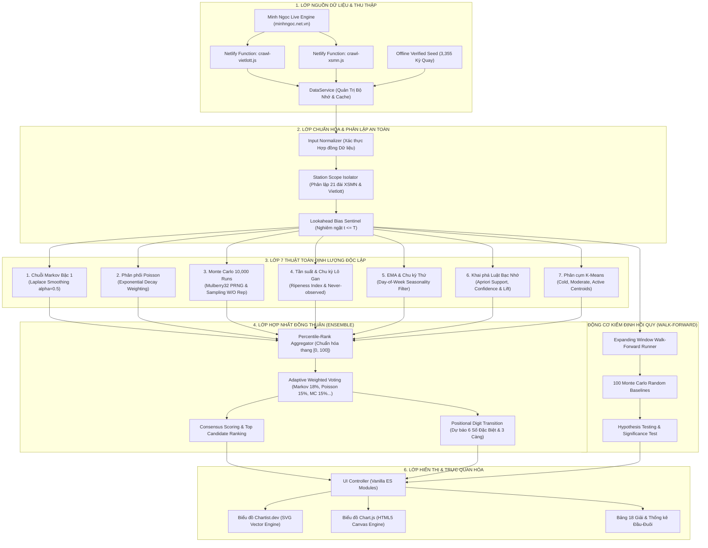
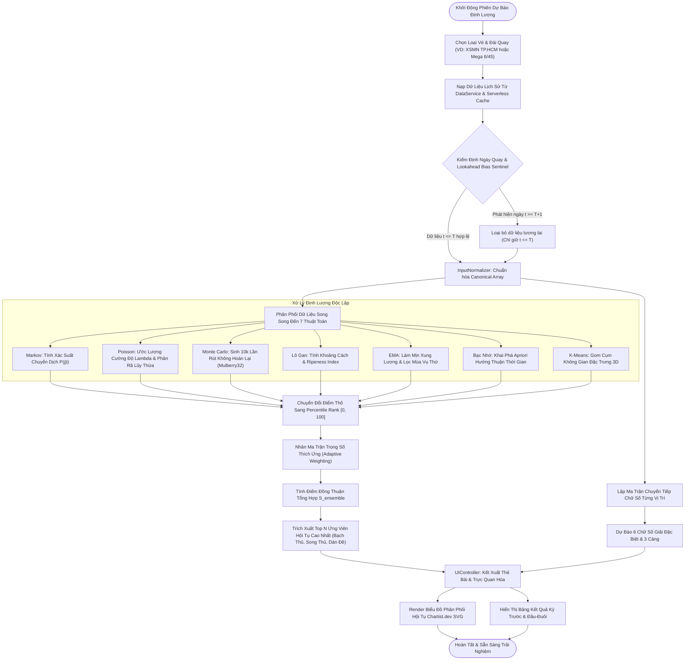
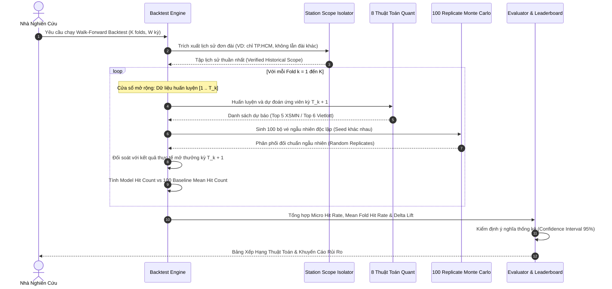
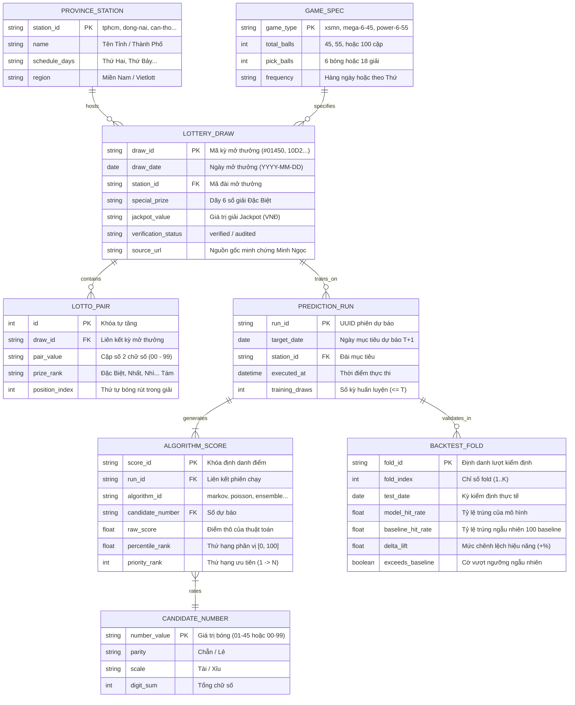

# 🎰 LOTTO-QUANT LAB

> **Hệ Thống Phân Tích Xác Suất & Kiểm Định Hồi Quy Xổ Số Định Lượng**  
> *Áp dụng Toán học Thống kê, Mô phỏng Monte Carlo, Học máy Phân cụm & Trực quan hóa Biểu đồ Chartist.dev SVG.*

[](https://sonaoday.netlify.app/)
[](LICENSE)
[](#iii-chi-tiết-8-thuật-toán-định-lượng--mô-hình-ai)
[](#v-tính-toàn-vẹn-dữ-liệu--sơ-đồ-thực-thể-quan-hệ-erd)
[](#vi-kiến-trúc-kỹ-thuật--hiệu-năng-vượt-trội)

---

## 📑 Mục Lục
1. [Tổng Quan & Triết Lý Khoa Học](#i-tổng-quan--triết-lý-khoa-học)
2. [Sơ Đồ Kiến Trúc Hệ Thống Tổng Thể](#ii-sơ-đồ-kiến-trúc-hệ-thống-tổng-thể)
3. [Chi Tiết 8 Thuật Toán Định Lượng & Mô Hình AI](#iii-chi-tiết-8-thuật-toán-định-lượng--mô-hình-ai)
   - [Lưu Đồ Quy Trình Dự Báo Định Lượng](#lưu-đồ-quy-trình-dự-báo-định-lượng)
   - [1. Mô Hình Tổng Hợp (Ensemble Consensus Model)](#1-mô-hình-tổng-hợp-ensemble-consensus-model)
   - [2. Chuỗi Markov Bậc 1 & Ma Trận Chuyển Dịch Trạng Thái](#2-chuỗi-markov-bậc-1--ma-trận-chuyển-dịch-trạng-thái)
   - [3. Phân Phối Poisson & Tần Suất Thực Nghiệm](#3-phân-phối-poisson--tần-suất-thực-nghiệm)
   - [4. Mô Phỏng Số Học Monte Carlo 10.000 Kịch Bản](#4-mô-phỏng-số-học-monte-carlo-10000-kịch-bản)
   - [5. Tần Suất & Chu Kỳ Lô Gan (Ripeness Index)](#5-tần-suất--chu-kỳ-lô-gan-ripeness-index)
   - [6. Đường Trung Bình Trượt Lũy Thừa (EMA) & Chu Kỳ Thứ](#6-đường-trung-bình-trượt-lũy-thừa-ema--chu-kỳ-thứ)
   - [7. Khai Phá Luật Bạc Nhớ (Association Rules Mining)](#7-khai-phá-luật-bạc-nhớ-association-rules-mining)
   - [8. Phân Cụm K-Means & Đặc Trưng Cấu Trúc (K-Means Clustering)](#8-phân-cụm-k-means--đặc-trưng-cấu-trúc-k-means-clustering)
4. [Động Cơ Kiểm Định Hồi Quy (Walk-Forward Backtesting Engine)](#iv-động-cơ-kiểm-định-hồi-quy-walk-forward-backtesting-engine)
5. [Tính Toàn Vẹn Dữ Liệu & Sơ Đồ Thực Thể Quan Hệ (ERD)](#v-tính-toàn-vẹn-dữ-liệu--sơ-đồ-thực-thể-quan-hệ-erd)
6. [Kiến Trúc Kỹ Thuật & Hiệu Năng Vượt Trội](#vi-kiến-trúc-kỹ-thuật--hiệu-năng-vượt-trội)
7. [Hướng Dẫn Cài Đặt & Triển Khai (Deployment)](#vii-hướng-dẫn-cài-đặt--triển-khai-deployment)
8. [Tuyên Bố Miễn Trừ Trách Nhiệm (Disclaimer)](#viii-tuyên-bố-miễn-trừ-trách-nhiệm-disclaimer)

---

## I. Tổng Quan & Triết Lý Khoa Học

**LOTTO-QUANT LAB** là nền tảng điện toán mã nguồn mở chuyên sâu về nghiên cứu xác suất thống kê cho dữ liệu xổ số truyền thống tại Việt Nam:
* **Xổ Số Kiến Thiết Miền Nam (XSMN):** Toàn bộ 21 tỉnh thành (TP.HCM, Cần Thơ, Đồng Nai, Tây Ninh, An Giang,...), phân tích cấu trúc 18 giải và đuôi lô tô 2 số.
* **Xổ Số Điện Toán Vietlott:** Ma trận 6/45 (Mega 6/45) và 6/55 (Power 6/55) cùng Jackpot tích lũy.

### 🛡️ Nguyên Tắc "Evidence Before Assertion" & Chống Ngụy Biện Con Bạc
1. **Tôn trọng tính ngẫu nhiên độc lập:** Mỗi vòng quay của lồng cầu khí nén vật lý là một biến cố ngẫu nhiên độc lập về mặt cơ học. Các mô hình định lượng trong hệ thống **không** tuyên bố dự đoán chuẩn xác 100%, mà tập trung lượng hóa sự lệch pha thống kê thực nghiệm (Empirical Distribution Anomalies).
2. **Loại bỏ Ngụy biện Con Bạc (Gambler's Fallacy):** Hệ thống không giả định rằng một con số "đã lâu chưa ra thì sắp tới chắc chắn phải ra". Thuật toán Lô Gan và Chu kỳ chỉ tính toán độ chín tương đối để nhà nghiên cứu có góc nhìn đa chiều về rủi ro.
3. **Triệt tiêu Thiên kiến Nhìn trước (Lookahead Bias Prevention):** Mọi mô hình huấn luyện chỉ được phép nhìn thấy dữ liệu quá khứ $t \le T$ để đưa ra dự báo cho kỳ $T+1$.

---

## II. Sơ Đồ Kiến Trúc Hệ Thống Tổng Thể

Kiến trúc phân tầng chặt chẽ từ thu thập dữ liệu, làm sạch, mô hình hóa toán học đến trực quan hóa đa nền tảng:



---

## III. Chi Tiết 8 Thuật Toán Định Lượng & Mô Hình AI

Mỗi thuật toán trong hệ thống được thiết kế theo hợp đồng thống nhất: nhận tập lịch sử chuẩn hóa `sortedHistory` và trả về danh sách ứng viên `predictions`, ma trận điểm số `scores`, loại điểm `scoreType: "ranking-score"` cùng giải trình toán học minh bạch.

### Lưu Đồ Quy Trình Dự Báo Định Lượng



---

### 1. Mô Hình Tổng Hợp (Ensemble Consensus Model)
* **Tệp mã nguồn:** `xo-so/js/algorithms/ensemble.js`
* **Ý tưởng cốt lõi:** Dựa trên nguyên lý **Trí Tuệ Tập Thể (Wisdom of Crowds)** trong học máy. Thay vì đặt niềm tin vào một thuật toán đơn lẻ, mô hình tổng hợp dung hòa tín hiệu từ 7 mô hình thành phần để giảm thiểu phương sai (Variance Reduction) và hạn chế overfitting.
* **Cơ chế Tổng hợp (Percentile-Rank Aggregation):**
  Mỗi thuật toán thành phần chấm điểm cho các con số theo thang đo riêng. Để tránh việc một thuật toán có biên độ điểm lớn lấn át các thuật toán khác, hệ thống chuyển đổi điểm thô thành **Thứ hạng Phân vị (Percentile Rank)** nằm trong đoạn $[0, 100]$:
  $$\text{PercentileRank}_m(i) = \frac{\text{Rank}_m(i) - 1}{N - 1} \times 100$$
  Điểm số tổng hợp của số $i$ là trung bình có trọng số thích ứng:
  $$S_{\text{ensemble}}(i) = \sum_{m=1}^{7} w_m \cdot \text{PercentileRank}_m(i)$$
* **Bảng Phân Bổ Trọng Số Thực Nghiệm:**
  * Chuỗi Markov Bậc 1: **18%**
  * Phân phối Poisson & Tần suất: **15%**
  * Mô phỏng Monte Carlo (10k): **15%**
  * Tần suất & Chu kỳ Lô Gan: **14%**
  * EMA & Chu kỳ Thứ: **13%**
  * Khai phá Luật Bạc Nhớ: **13%**
  * Phân cụm K-Means: **12%**
* **Dự báo 6 Số Giải Đặc Biệt XSMN:** Phân tích ma trận chuyển tiếp chữ số thực nghiệm theo từng vị trí (Hàng Trăm Ngàn, Chục Ngàn, Ngàn, Trăm, Chục, Đơn vị) kết hợp làm mượt Laplace, đưa ra dãy số hoàn chỉnh (Ví dụ: `393155`) gồm 3 Càng (`155`) và Bạch Thủ Đề (`55`).

---

### 2. Chuỗi Markov Bậc 1 & Ma Trận Chuyển Dịch Trạng Thái
* **Tệp mã nguồn:** `xo-so/js/algorithms/markov.js`
* **Ý tưởng cốt lõi:** Mô hình hóa xác suất chuyển dịch có điều kiện giữa hai kỳ mở thưởng liên tiếp. Nếu kỳ trước xuất hiện tập hợp số $A$, kỳ tiếp theo xác suất chuyển sang số $B$ là bao nhiêu?
* **Công Thức Toán Học:**
  $$P(X_t = j \mid X_{t-1} = i) = \frac{C(i \to j) + \alpha}{\sum_{k \in \Omega} [C(i \to k) + \alpha]}$$
  Trong đó:
  * $C(i \to j)$ là số lần con số $j$ xuất hiện ngay sau khi con số $i$ xuất hiện ở kỳ trước đó.
  * $\alpha = 0.5$ là hệ số làm mượt **Bayesian Laplace Smoothing** nhằm triệt tiêu xác suất 0 đối với các trạng thái chuyển dịch hiếm gặp trong cỡ mẫu ngắn hạn.
* **Cách làm:** Xây dựng ma trận chuyển dịch kích thước $45 \times 45$ (Vietlott) hoặc $100 \times 100$ (XSMN), trích xuất trạng thái xuất phát từ kỳ mở thưởng gần nhất, tính điểm xác suất thoát có điều kiện và chuẩn hóa xếp hạng.

---

### 3. Phân Phối Poisson & Tần Suất Thực Nghiệm
* **Tệp mã nguồn:** `xo-so/js/algorithms/poisson.js`
* **Ý tưởng cốt lõi:** Biến cố xuất hiện của một con số trong kỳ quay được mô hình hóa như một quá trình Poisson với tham số cường độ kỳ vọng $\lambda_i$ (Expected Occurrences).
* **Công Thức Toán Học:**
  $$\lambda_i = \frac{1}{\sum w_t} \sum_{t=1}^{T} w_t \cdot \mathbb{I}(i \in \text{Draw}_t)$$
  Hàm khối xác suất Poisson để số $i$ xuất hiện $k$ lần:
  $$P(X_i = k) = \frac{\lambda_i^k e^{-\lambda_i}}{k!}$$
  Xác suất con số $i$ xuất hiện **ít nhất một lần** trong kỳ quay tiếp theo:
  $$P(X_i \ge 1) = 1 - e^{-\lambda_i}$$
* **Trọng số phân rã thời gian (Exponential Decay):** Các kỳ quay gần được áp trọng số cao hơn các kỳ quay xa theo hàm mũ $w_t = e^{-\gamma \cdot t}$ giúp phản ánh kịp thời sự biến thiên phong độ của từng con số.

---

### 4. Mô Phỏng Số Học Monte Carlo 10.000 Kịch Bản
* **Tệp mã nguồn:** `xo-so/js/algorithms/monte-carlo.js`
* **Ý tưởng cốt lõi:** Sử dụng phương pháp mô phỏng số ngẫu nhiên lặp lại 10.000 kịch bản mở thưởng giả lập độc lập dựa trên hàm mật độ xác suất thực nghiệm tích lũy từ lịch sử.
* **Bộ Sinh Số Ngẫu Nhiên Xác Định (Mulberry32 PRNG):**
  Khởi tạo seed xác định bằng hàm băm FNV-1a Murmur32 băm chuỗi canonical toàn bộ lịch sử quay thưởng. Đảm bảo 100% tính tái lập (Reproducibility): cùng một dữ liệu đầu vào luôn cho ra chính xác cùng kết quả mô phỏng trên mọi trình duyệt.
* **Lấy mẫu có trọng số KHÔNG HOÀN LẠI (Weighted Sampling Without Replacement):**
  Đối với Vietlott, thuật toán mô phỏng quá trình rút lần lượt từng quả bóng từ lồng cầu. Mỗi khi một quả bóng được rút ra, trọng số của nó bị loại khỏi không gian lấy mẫu, đảm bảo không bao giờ sinh ra bóng số trùng lặp trong cùng một vé.
* **Định lượng Sai Số Thống Kê (Standard Error):**
  $$\text{SE} = \sqrt{\frac{p(1 - p)}{N_{\text{simulations}}}}$$
  Với $N = 10.000$, sai số tiêu chuẩn đạt mức cực thấp ($\approx 0.003$), đảm bảo độ tin cậy của bảng xếp hạng.

---

### 5. Tần Suất & Chu Kỳ Lô Gan (Ripeness Index)
* **Tệp mã nguồn:** `xo-so/js/algorithms/frequency-gap.js`
* **Ý tưởng cốt lõi:** Lượng hóa độ "chín" (Ripeness) của từng con số bằng cách so sánh khoảng cách kỳ chưa về hiện tại (Current Gap) với chu kỳ xuất hiện trung bình trong lịch sử (Average Cycle).
* **Công Thức Toán Học:**
  $$\text{Average Cycle } \bar{C}_i = \frac{T - \text{First Appearance}}{\text{Total Hits}_i}$$
  $$\text{Ripeness Index } R_i = \frac{\text{Current Gap}_i}{\bar{C}_i}$$
* **Xử lý Biên Đặc Biệt (Never-Observed Isolation):**
  Những con số chưa từng xuất hiện trong cửa sổ phân tích được phân loại trạng thái riêng biệt `evidenceStatus: "never-observed"`, gán `avgCycle = null` và `ripenessIndex = null` để ngăn chặn việc thuật toán tự ý nội suy điểm số ảo khi chưa có dữ liệu quan sát.

---

### 6. Đường Trung Bình Trượt Lũy Thừa (EMA) & Chu Kỳ Thứ
* **Tệp mã nguồn:** `xo-so/js/algorithms/moving-average.js`
* **Ý tưởng cốt lõi:** Áp dụng giải thuật làm mịn tín hiệu kỹ thuật để triệt tiêu các nhiễu ngẫu nhiên ngắn hạn, trích xuất xu hướng xung lượng tần suất (Momentum).
* **Công Thức Toán Học:**
  $$\text{EMA}_t(i) = \alpha \cdot Y_t(i) + (1 - \alpha) \cdot \text{EMA}_{t-1}(i), \quad \alpha = \frac{2}{N_{\text{span}} + 1}$$
* **Mô Hình Hóa Mùa Vụ Theo Thứ (Day-of-Week Seasonality):**
  Xổ số các đài miền Nam quay định kỳ theo các ngày cố định trong tuần (ví dụ: Đài TP.HCM quay Thứ Hai và Thứ Bảy). Thuật toán tự động phân tách và tính toán chu kỳ theo đúng Thứ của ngày mở thưởng sắp tới để bắt nhịp chính xác chu kỳ quay thưởng địa phương.

---

### 7. Khai Phá Luật Bạc Nhớ (Association Rules Mining)
* **Tệp mã nguồn:** `xo-so/js/algorithms/association-rules.js`
* **Ý tưởng cốt lõi:** Lượng hóa các quy luật dân gian "bạc nhớ" thành các luật kết hợp thống kê chặt chẽ theo thuật toán Apriori kinh điển.
* **Bộ Ba Chỉ Số Định Lượng:**
  * **Độ Hỗ Trợ (Support):** Tần suất xuất hiện đồng thời của tiền đề và hệ quả:
    $$\text{Support}(A \to B) = P(A \cap B) = \frac{\text{Count}(A \cap B)}{N}$$
  * **Độ Tin Cậy (Confidence):** Xác suất có điều kiện khi có $A$ thì $B$ xuất hiện:
    $$\text{Confidence}(A \to B) = P(B \mid A) = \frac{\text{Count}(A \cap B)}{\text{Count}(A)}$$
  * **Độ Nâng (Lift):** Mức độ tăng xác suất của $B$ nhờ sự xuất hiện của $A$:
    $$\text{Lift}(A \to B) = \frac{P(A \cap B)}{P(A) \cdot P(B)}$$
* **Định Hướng Nghiêm Ngặt Chiều Thời Gian:** Luật chỉ được học theo chiều thuận thời gian ($T_{k-1} \to T_k$), nghiêm cấm học ngược chiều thời gian ($T_k \to T_{k-1}$) nhằm triệt tiêu hoàn toàn rủi ro rò rỉ dữ liệu.

---

### 8. Phân Cụm K-Means & Đặc Trưng Cấu Trúc (K-Means Clustering)
* **Tệp mã nguồn:** `xo-so/js/algorithms/clustering.js`
* **Ý tưởng cốt lõi:** Gom cụm các con số trong không gian tiềm ẩn đa chiều (Latent Feature Space) để hỗ trợ đa dạng hóa danh mục vé số, tránh việc dồn toàn bộ lựa chọn vào một nhóm số cục bộ.
* **Không Gian Vector Đặc Trưng 3 Chiều:**
  Mỗi con số $i$ được biểu diễn bằng vector $\mathbf{x}_i = [f_i, g_i, v_i]^T$:
  * $f_i$: Tần suất xuất hiện chuẩn hóa trong cửa sổ 30 kỳ gần nhất $[0, 1]$.
  * $g_i$: Khoảng cách số kỳ chưa về chuẩn hóa $[0, 1]$.
  * $v_i$: Giá trị số học của quả bóng được chuẩn hóa theo độ lớn $[0, 1]$.
* **Phân Cụm $K = 3$ (Cold, Moderate, Active):**
  Thuật toán tối thiểu hóa tổng bình phương khoảng cách Euclid đến tâm cụm $\boldsymbol{\mu}_j$:
  $$J = \sum_{j=1}^{3} \sum_{\mathbf{x} \in S_j} \|\mathbf{x} - \boldsymbol{\mu}_j\|^2$$
  Hội tụ sau tối đa 20 vòng lặp hoặc khi độ dịch chuyển tâm cụm $\Delta < 10^{-4}$.

---

## IV. Động Cơ Kiểm Định Hồi Quy (Walk-Forward Backtesting Engine)

Một hệ thống định lượng không có kiểm định hồi quy là một hệ thống thiếu tin cậy. **LOTTO-QUANT LAB** trang bị động cơ Backtest chuẩn mực:



* **Cửa Sổ Mở Rộng (Expanding Window):**
  Huấn luyện mô hình từ kỳ đầu tiên đến kỳ $T$, dự báo kỳ $T+1$. Sau đó mở rộng tập huấn luyện thêm kỳ $T+1$ để dự báo kỳ $T+2$. Không bao giờ cắt xén âm thầm lịch sử.
* **So Sánh Đối Chuẩn (Random Baseline 100 Replicates):**
  Để chứng minh tính hiệu quả của mô hình, hệ thống chạy 100 bộ sinh số ngẫu nhiên độc lập làm đối chuẩn (Baseline), tính toán:
  * Tỷ lệ trúng thực tế của mô hình (Model Hit Rate)
  * Tỷ lệ trúng của Baseline ngẫu nhiên (Baseline Hit Rate)
  * Mức chênh lệch hiệu năng: $\Delta = \text{HitRate}_{\text{model}} - \text{HitRate}_{\text{baseline}}$
  * Khoảng tin cậy 95% (95% Confidence Interval) và mức ý nghĩa thống kê.

---

## V. Tính Toàn Vẹn Dữ Liệu & Sơ Đồ Thực Thể Quan Hệ (ERD)

Mọi bản ghi kết quả đều được tổ chức có cấu trúc, quan hệ ràng buộc chặt chẽ và lưu trữ nguồn gốc xác thực (Data Provenance):



* **Quy mô Dữ liệu Xác thực:** 3.355 kỳ quay thực tế được lưu trữ có nguồn gốc rõ ràng (Data Provenance):
  * **1.576 kỳ** Mega 6/45 từ ngày đầu tiên (2016 đến nay).
  * **1.411 kỳ** Power 6/55 (bao gồm kỳ nổ Jackpot lịch sử 321 tỷ VNĐ #00098).
  * **352 kỳ** XSMN chuẩn hóa theo 21 đài mở thưởng.
* **Phân Lập Đài Tuyệt Đối (Station Scope Isolation):**
  Khi phân tích đài TP.HCM, hệ thống nghiêm ngặt chỉ nạp lịch sử quay của đài TP.HCM, không bao giờ lẫn lộn giải thưởng của các đài Cần Thơ, Đồng Tháp hoặc Tiền Giang mở cùng ngày.

---

## VI. Kiến Trúc Kỹ Thuật & Hiệu Năng Vượt Trội

```
├── Web/
│   ├── netlify.toml               # Cấu hình triển khai Netlify từ root repo
│   ├── package.json               # Quản lý workspace & scripts kiểm định
│   ├── .gitignore                 # Loại trừ file rác, file fix & chat history
│   └── xo-so/                     # Thư mục ứng dụng Web chính thức
│       ├── index.html             # Giao diện đơn trang chuẩn Semantic HTML5
│       ├── 404.html               # Trang báo lỗi 404 tùy biến Glassmorphism
│       ├── _redirects             # Quy tắc điều hướng Serverless Netlify
│       ├── _headers               # Cấu hình Security Headers & Caching Policy
│       ├── css/                   # Vanilla CSS tối ưu hóa tốc độ render
│       │   ├── main.css           # Bảng màu Amber Gold, Dark Mode, Typography
│       │   ├── components.css     # Thẻ bài số học, bảng giải thưởng, modal
│       │   └── chartist.min.css   # Stylesheet chính thức của Chartist.dev
│       ├── js/                    # Native JavaScript ES Modules
│       │   ├── app.js             # Entrypoint khởi tạo hệ thống
│       │   ├── data-service.js    # Quản trị dữ liệu, cào dữ liệu & lưu trữ
│       │   ├── ui-controller.js   # Điều phối giao diện & render Chartist/Chart.js
│       │   └── algorithms/        # Thư mục 8 thuật toán định lượng độc lập
│       │       ├── ensemble.js
│       │       ├── markov.js
│       │       ├── poisson.js
│       │       ├── monte-carlo.js
│       │       ├── frequency-gap.js
│       │       ├── moving-average.js
│       │       ├── association-rules.js
│       │       └── clustering.js
│       ├── netlify/functions/     # Serverless Functions cào dữ liệu thời gian thực
│       │   ├── crawl-vietlott.js  # Cào trực tiếp kết quả Mega & Power từ Minh Ngọc
│       │   └── crawl-xsmn.js      # Cào bảng 18 giải XSMN theo từng tỉnh thành
│       └── test/                  # Bộ kiểm thử tự động toàn diện
│           ├── test-unit.js       # 60 bài Unit Test kiểm tra logic thuật toán
│           ├── test-integration.js# 33 bài Integration Test kiểm toán dữ liệu
│           └── test-e2e.js        # Kiểm thử luồng người dùng End-to-End
```

### 📊 Điểm Nhấn Công Nghệ: Biểu Đồ Kép Chartist.dev & Chart.js
* **Chartist.dev v2.2.0 (SVG Engine):** Thư viện biểu đồ vector thuần túy dung lượng siêu nhỏ (<10KB), render 30 cột phân phối xác suất sắc nét từng điểm ảnh trên màn hình Retina, không bị vỡ hình khi zoom.
* **Chart.js (Canvas Engine):** Tùy chọn chuyển đổi tức thì sang biểu đồ Canvas tương tác, cung cấp góc nhìn đa chiều cho chuyên gia dữ liệu.

---

## VII. Hướng Dẫn Cài Đặt & Triển Khai (Deployment)

### 1. Chạy Tại Máy Cục Bộ (Local Development)
Yêu cầu: Node.js 18+ trở lên.

```bash
# Di chuyển vào thư mục ứng dụng
cd xo-so

# Chạy toàn bộ 60 bài Unit Test kiểm định thuật toán
node test/test-unit.js

# Chạy 33 bài Integration Test kiểm tra dữ liệu
node test/test-integration.js

# Khởi chạy máy chủ cục bộ bằng PowerShell script có sẵn
powershell -ExecutionPolicy Bypass -File scripts/serve.ps1
```
Mở trình duyệt truy cập: `http://localhost:8088/`

---

### 2. Triển Khai Lên Netlify Cloud (1-Click Deploy)
Hệ thống đã cấu hình đầy đủ sẵn sàng:
1. Đăng nhập [Netlify](https://app.netlify.com/) $\to$ **Add new site** $\to$ **Import an existing project**.
2. Chọn repo GitHub: **`nhannguyenhcm95/lotto-quant-lab`**.
3. Các thông số tự động:
   * **Base directory:** *(để trống)*
   * **Build command:** `echo 'Static site ready for deployment'`
   * **Publish directory:** `xo-so`
   * **Functions directory:** `xo-so/netlify/functions`
4. Bấm **Deploy**. Trang web sẽ online toàn cầu với chứng chỉ SSL HTTPS miễn phí!

---

## VIII. Tuyên Bố Miễn Trừ Trách Nhiệm (Disclaimer)

1. **Mục đích Học thuật & Nghiên cứu:** **LOTTO-QUANT LAB** là dự án nghiên cứu khoa học thuần túy nhằm ứng dụng các phương pháp phân tích chuỗi thời gian, lý thuyết thông tin và học máy vào tập dữ liệu số học thực tế.
2. **Không Khuyến Khích Cờ Bạc:** Dự án **tuyệt đối không** cổ xúy hoặc khuyến khích bất kỳ hình thức cá cược, lô đề bất hợp pháp nào. Người dùng cần tuân thủ nghiêm túc các quy định pháp luật của Nhà nước Việt Nam về việc mua vé số ích nước lợi nhà do các Công ty Xổ số Kiến thiết và Công ty Xổ số Điện toán Việt Nam (Vietlott) phát hành.
3. **Rủi ro Tài chính:** Mọi gợi ý phân tích chỉ mang tính chất tham khảo định lượng. Tác giả không chịu trách nhiệm đối với bất kỳ quyết định tài chính cá nhân nào của người sử dụng.
